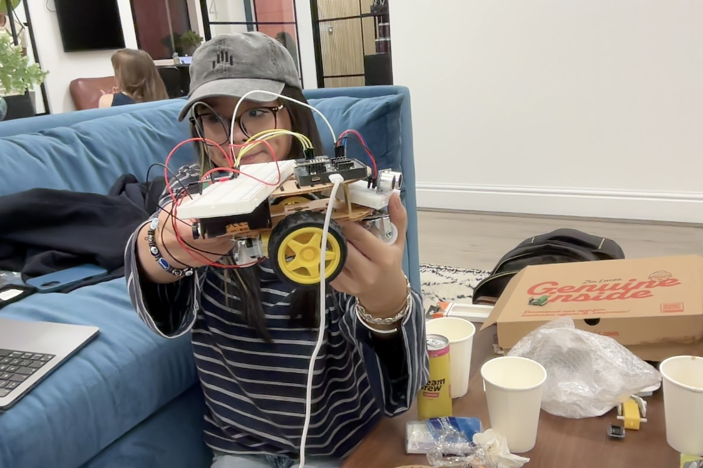
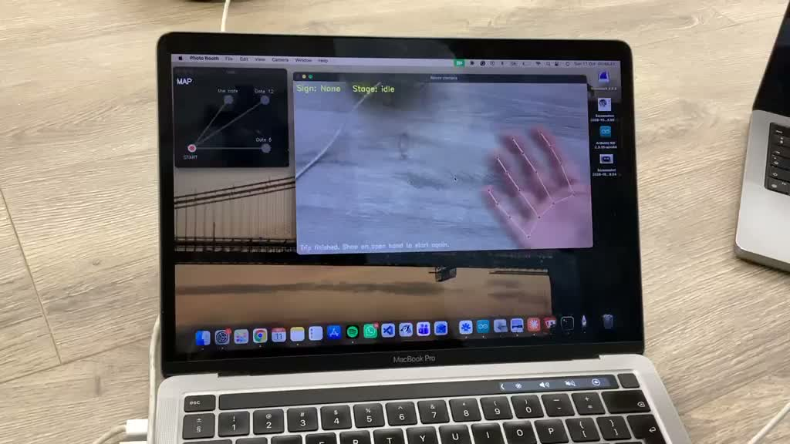
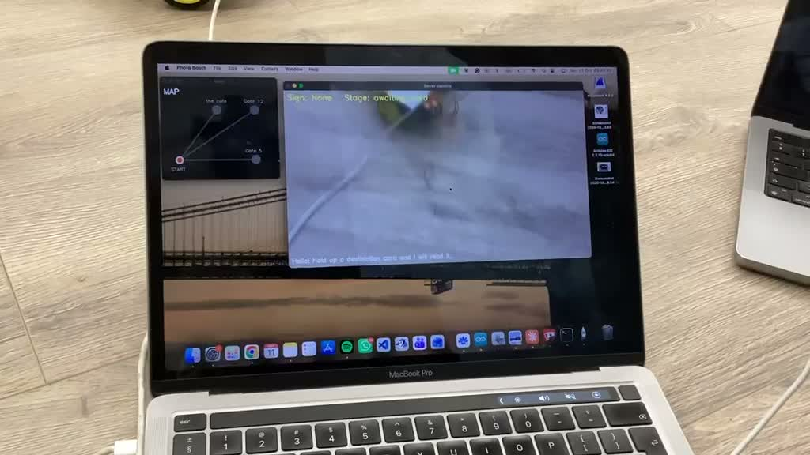
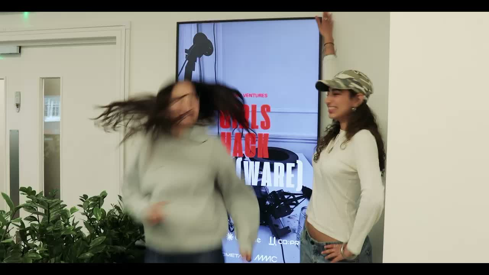
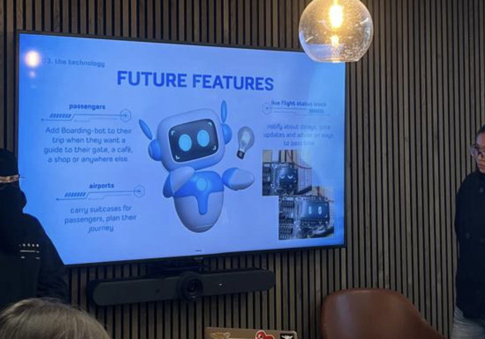

# Boarding Bot

An autonomous airport gate guide robot built at Girls Hack Hard 2026.

Boarding Bot walks passengers to their gate — door to door. It uses computer vision to track passengers, waypoint navigation to follow predefined routes, and ultrasonic sensing to avoid obstacles.



## How it works

```
iPhone Camera → Laptop (YOLO detection + navigation) → WiFi → ESP32 rover → motors
```

1. Passenger selects their gate
2. Rover looks up the route (predefined waypoints)
3. Rover drives toward each waypoint while checking the passenger is following
4. If the passenger falls behind, the rover stops and waits
5. If an obstacle appears, the rover avoids it
6. Arrives at gate

## Demo







### Videos

- [Rover navigation demo](media/rover-demo-1.mp4)
- [Hackathon event](media/rover-demo-2.mp4)

## Future Features



- **Passengers** — Add Boarding Bot to their trip when they want a guide to their gate, a cafe, a shop, or anywhere else
- **Airports** — Carry suitcases for passengers, plan their journey
- **Live flight status** — Notify about delays, gate updates, and advise on things to pass time

## Tech stack

| Layer | Tech |
|---|---|
| Vision | YOLO11 nano + OpenCV |
| Navigation | Python waypoint engine with dead reckoning |
| Passenger tracking | YOLO person detection |
| Obstacle avoidance | Camera (far) + HC-SR04 ultrasonic (close) |
| Communication | HTTP over WiFi |
| Motor control | ESP32-S3 + L9110S driver |
| Hardware | Axiometa Genesis Mini + DollaTek 2WD chassis |
| Display | ST7735 TFT with animated face |

## Hardware (~£47)

- Axiometa Genesis Mini (ESP32-S3)
- DollaTek 2WD Smart Robot Car Chassis Kit
- L9110S motor driver
- HC-SR04 ultrasonic sensor
- ST7735 TFT display (AX22-0034)
- 2x AA batteries

## Software setup

```bash
python3 -m venv .venv
source .venv/bin/activate
pip install opencv-python ultralytics requests
```

### Run detection (camera only)
```bash
python3 detect.py
```

### Run gate guide (full navigation)
```bash
python3 gate_guide.py
```

### Flash the rover
Open `genesis_wifi_server/genesis_wifi_server.ino` in Arduino IDE, set your WiFi credentials, and upload to the Genesis Mini.

## Project structure

```
├── gate_guide.py              # main navigation + passenger tracking
├── detect.py                  # YOLO object detection standalone
├── navigate.py                # waypoint navigation standalone
├── reolink_stream.py          # camera stream viewer
├── find_camera.py             # camera index scanner
├── genesis_wifi_server/       # ESP32 firmware (Arduino)
├── shell.scad                 # 3D printable shell (OpenSCAD)
├── product_render.scad        # product concept render (OpenSCAD)
└── media/                     # photos and videos
```

## Built at

Girls Hack Hard 2026, Cancun
